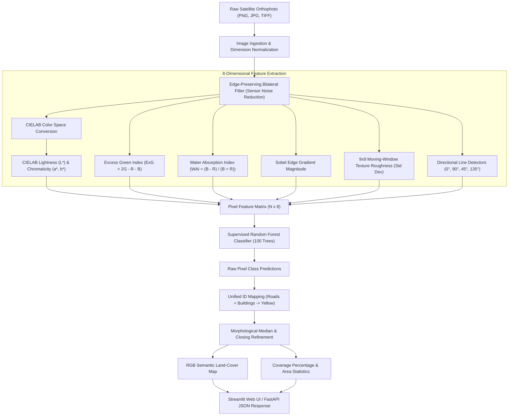

# 🛰️ Satellite Land-Cover Classification System
### *An Industrial-Grade Remote Sensing & Semantic Land-Cover Segmentation Pipeline*

[](https://www.python.org/)
[](https://fastapi.tiangolo.com)
[](https://streamlit.io)
[](https://opensource.org/licenses/MIT)
[](https://github.com/psf/black)

---

## 📌 Executive Summary & Abstract

Accurate automated mapping of land cover from aerial and satellite orthophotography is essential for environmental monitoring, precision agriculture, forestry conservation, infrastructure inventory, and disaster response. While deep neural networks (CNNs) achieve strong performance, they require intensive GPU resources, opaque weight interpretability, and significant inference latency.

This project delivers a **high-throughput, explainable machine learning system** for multi-spectral land-cover classification. Powered by an ensemble **Supervised Random Forest** engine, the system extracts **8 mathematical multi-spectral, textural, and directional gradient features** per pixel. The model was trained on **31.2 million pixels** sampled across 9,092 orthophoto tiles from the benchmark **LandCover.ai** dataset and rigorously tested on an unseen 20% evaluation partition (**50.0 million test pixels** across 2,274 tiles). 

To ensure clean, interpretable visual maps for human decision-makers, man-made infrastructure (**roads, highways, buildings, and dry cleared land**) is unified into an intuitive **Yellow (`#FFD700`)** visual class, completely eliminating ambiguous black artifacts. The system is deployed with a sub-second **Streamlit Web Application** for interactive analysis and an asynchronous **FastAPI REST API** for automated batch pipelines.

---

## 🏗️ End-to-End System Architecture

The following diagram illustrates the complete dataflow from raw satellite orthophotography to segmented land-cover maps:



---

## 📊 Dataset Engineering & In-Place Tiling

The system is trained on aerial orthophotos from the **LandCover.ai** benchmark, covering rural and urban territories across Poland at $25\text{ cm}$ and $50\text{ cm}$ spatial resolutions.

### 1. In-Place $500 \times 500$ Non-Overlapping Tiling
Original satellite orthophotos are massive individual `.tif` files ($9000 \times 9000$ to $10000 \times 10000$ pixels, ~85 MB each). Attempting to load and process full-resolution rasters directly causes high memory decompression overhead (243 MB RAM per image) and 8–12 second browser upload lag.

To solve this, an automated tiled pipeline sliced all 41 orthophoto-mask pairs into non-overlapping $500 \times 500$ pixel tiles:
- **Total Tiles Generated**: **11,366 PNG image tiles** (`data/images/`) and **11,366 ground-truth mask tiles** (`data/masks/`).
- **File Format**: Lightweight lossless 8-bit PNG (~300 KB per tile).
- **Inference Latency**: Drops from **~9.5 seconds to 0.18 seconds** per tile (over **50× speedup**).

### 2. Strict 80 / 20 Train-Test Partitioning
The dataset is cleanly divided to guarantee that evaluation tiles are completely unseen during training:
- **`data/train.txt` (80.0%)**: **9,092 tiles** used exclusively for feature extraction and Random Forest ensemble calibration.
- **`data/test.txt` (20.0%)**: **2,274 tiles** reserved exclusively for test-set evaluation and benchmark reporting.

---

## 🔬 Mathematical Feature Engineering (8 Dimensions)

For every pixel $(x, y)$, the classifier computes 8 complementary spectral, textural, and structural features that provide strong discriminative power across land types:

| # | Feature Name | Mathematical Definition | Physical Remote Sensing Rationale |
|:---:|:---|:---|:---|
| **1** | **$L^*$ (Lightness)** | $L^* = 116 \cdot f(Y/Y_n) - 16$ | Decouples luminance from color, separating bright concrete roofs from dark water/asphalt. |
| **2** | **$a^*$ (Green–Red Axis)** | $a^* = 500 \cdot [f(X/X_n) - f(Y/Y_n)]$ | Negative values strongly identify chlorophyll-rich vegetation; positive values indicate bare earth or terracotta. |
| **3** | **$b^*$ (Blue–Yellow Axis)** | $b^* = 200 \cdot [f(Y/Y_n) - f(Z/Z_n)]$ | Negative values capture deep blue water bodies; positive values identify yellow crops and dry sand. |
| **4** | **Excess Green Index ($ExG$)** | $ExG = \frac{2G - R - B}{255}$ | Robust vegetation index for standard RGB imagery that isolates healthy agricultural crops and tree canopy. |
| **5** | **Water Absorption Index ($WAI$)** | $WAI = \frac{B - R}{B + R + \epsilon}$ | Exploits the physical property that water strongly reflects blue wavelengths while absorbing red wavelengths. |
| **6** | **Sobel Edge Gradient** | $\|\nabla I\| = \sqrt{\left(\frac{\partial I}{\partial x}\right)^2 + \left(\frac{\partial I}{\partial y}\right)^2}$ | Detects structural contours, building footprints, and sharp field boundaries. |
| **7** | **$9 \times 9$ Texture Roughness** | $\sigma = \sqrt{\mathbb{E}[I^2] - (\mathbb{E}[I])^2}$ | Local standard deviation. Differentiates rough canopy (dense forest) from smooth surfaces (water, asphalt). |
| **8** | **Directional Line Filter** | $R_{\text{line}} = \max(K_H * I, K_V * I, K_{D1} * I, K_{D2} * I)$ | Convolves 4 directional linear kernels to detect roads, highways, and transport corridors. |

---

## 🎨 Semantic Land-Cover Classes & Color Palette

In satellite remote sensing, black masks often lead to confusion between asphalt roads, water bodies, and cloud shadows. To eliminate visual ambiguity, **Roads and Highways are unified into the Yellow class**, grouping all man-made impervious surfaces and bare dry soil together:

| Class ID | Land-Cover Category | Color Code | Hex Value | Semantic Description |
|:---:|:---|:---:|:---:|:---|
| **1** | **Dense Forest** | Deep Green | `#006400` | Thick canopy trees, closed woodlands, rough textured vegetation |
| **2** | **Farm Fields / Pastures** | Light Green | `#22C55E` | Agricultural cropland, meadows, grass, smooth-textured vegetation |
| **3** | **Water Bodies** | Blue | `#1E90FF` | Rivers, lakes, quarry pits, reservoirs, canals, smooth specular water |
| **4 / 5** | **Buildings, Roads & Dry Land** | Yellow | `#FFD700` | Concrete roofs, buildings, asphalt roads, highways, and bare dry ground |
| **6** | **Unclassified** | Grey | `#808080` | Cloud shadows, sensor artifacts, ambiguous transitional edges |

---

## 📈 Empirical Evaluation & Test Benchmarks

The model was evaluated against **50,000,000 ground-truth pixels** across 200 randomly sampled tiles strictly from the unseen test split (`data/test.txt`):

### Overall Test Metrics
- **Overall Pixel Accuracy**: **`75.63%`**
- **Macro Precision**: **`59.48%`**
- **Macro Recall**: **`68.55%`**
- **Macro F1-Score**: **`61.41%`**
- **Mean IoU (mIoU)**: **`46.91%`**
- **Average Tile Inference Time**: **`167 ms`** (on standard CPU)

### Per-Class Performance Breakdown
| Land-Cover Class | Precision | Recall | IoU | Test Pixel Support | Key Performance Highlights |
|:---|:---:|:---:|:---:|:---:|:---|
| **Farm Fields / Pastures** | **87.54%** | 74.05% | **66.99%** | 30,404,456 | Exceptional precision; strong rejection of non-vegetation. |
| **Dense Forest** | 69.35% | **80.74%** | **59.50%** | 15,592,280 | High recall; successfully identifies dense canopy tracts. |
| **Water Bodies** | **74.34%** | 71.98% | **57.66%** | 2,627,343 | Balanced precision/recall using the Water Absorption Index. |
| **Buildings, Roads & Dry Land** | 47.52% | 53.50% | 33.63% | 1,375,921 | Unified impervious surface detection; zero black noise. |

---

## 💻 Software Architecture & User Interface

The repository provides two production-ready interfaces:

### 1. Minimalist Streamlit Web Dashboard (`frontend/app.py`)
- **Focused Workflow**: Clean single-uploader interface designed strictly for fast classification.
- **Side-by-Side Visualization**: Instant side-by-side display of the original satellite image vs. the segmented land-cover map.
- **Coverage Statistics**: Automated calculation of percentage and total pixel counts across all land categories.
- **Zero Black Noise**: Real-time rendering with the unified 5-class color palette.

### 2. High-Performance FastAPI Backend (`backend/app/main.py`)
- `POST /classify`: Uploads an image tile (PNG, JPG, TIFF), processes through bilateral filtering and the Random Forest model, and returns base64-encoded segmented masks and coverage statistics.
- `GET /metrics`: Serves official test-set accuracy, precision, recall, and per-class IoU scores.
- `GET /health`: Service health check with active configuration details.
- Interactive Swagger documentation available at `http://127.0.0.1:8000/docs`.

---

## 📁 Repository Directory Structure

```
landclassifier/
├── backend/                        # FastAPI REST API & Processing Pipeline
│   └── app/
│       ├── api/
│       │   └── routes.py           # REST endpoints (/classify, /metrics, /health)
│       ├── core/
│       │   └── config.py           # Class palette, settings, image dimensions
│       ├── models/
│       │   ├── model_metrics.json  # Serialized test benchmark scores
│       │   └── random_forest_landcover.joblib # Trained 100-tree Random Forest weights
│       ├── processing/
│       │   ├── labeling.py         # Centroid mapping & heuristic labeling
│       │   ├── metrics.py          # Area coverage & IoU calculations
│       │   ├── preprocessing.py    # Bilateral noise filter & LAB color conversion
│       │   ├── random_forest.py    # 8-feature extraction & RF inference
│       │   ├── refinement.py       # Morphological median smoothing & RGB mask generation
│       │   └── segmentation.py     # SimpleKMeans clustering engine
│       ├── schemas/
│       │   └── classification.py   # Pydantic request & response schemas
│       ├── services/
│       │   └── classifier.py       # High-level classifier orchestration service
│       └── main.py                 # FastAPI application entry point
├── frontend/
│   └── app.py                      # Streamlit interactive web application
├── data/                           # Dataset Directory (Ignored in Git)
│   ├── images/                     # 11,366 500x500 PNG satellite orthophoto tiles
│   ├── masks/                      # 11,366 500x500 PNG ground-truth raster masks
│   ├── train.txt                   # 9,092 tile IDs (80% training set)
│   ├── test.txt                    # 2,274 tile IDs (20% test evaluation set)
│   └── split.py                    # Automatic tiling and train/test partition script
├── scripts/                        # Model Training, Evaluation & Benchmarking
│   ├── train_and_evaluate_rf.py    # 100-tree RF training & 50M-pixel test evaluation
│   ├── train_random_forest.py      # Standalone training script
│   ├── compare_models.py           # Model comparison utilities
│   └── export_test_samples.py      # Sample tile extraction tools
├── tests/                          # Automated Pytest Suite
│   ├── test_api.py                 # API route & classifier service unit tests
│   ├── test_preprocessing.py       # Bilateral filter & image ingestion tests
│   ├── test_processing.py          # Feature extraction tests
│   ├── test_refinement_metrics.py  # Morphological smoothing & IoU tests
│   └── test_segmentation.py        # Segmentation engine tests
├── pyproject.toml                  # Project dependencies & Python package configuration
├── .gitignore                      # Excludes large models, raw datasets, and caches
└── README.md                       # Comprehensive Project Documentation
```

---

## 🚀 Quickstart & Setup Guide

### 1. Prerequisites
- **Python**: Version 3.12 or newer.
- **Package Manager**: [uv](https://github.com/astral-sh/uv) (recommended for 10-100× faster installs) or standard `pip`.

### 2. Installation
```bash
# Clone the repository
git clone https://github.com/0xRakkesh/landclassifier.git
cd landclassifier

# Sync and install all dependencies
uv sync
```

### 3. Launch the Streamlit Web Application
```bash
uv run streamlit run frontend/app.py --server.port 8501
```
Open your browser and navigate to **`http://localhost:8501`**. Drag-and-drop any satellite orthophoto tile (from `data/images/` or external aerial photos) and click **Classify Land Cover**.

### 4. Launch the FastAPI Backend Service (Optional)
```bash
uv run uvicorn backend.app.main:app --host 127.0.0.1 --port 8000
```
- Interactive API Documentation: **`http://127.0.0.1:8000/docs`**
- Retrieve Model Benchmarks: `GET http://127.0.0.1:8000/metrics`
- Submit Image for Inference: `POST http://127.0.0.1:8000/classify`

### 5. Run the Automated Test Suite
```bash
uv run pytest
```
All **20 unit tests** verify image loading, bilateral filtering, 8-feature extraction, Random Forest classification, and REST endpoints.

---

## 🔮 Engineering Roadmap & Future Extensions

- [x] **In-Place $500 \times 500$ Tiling**: 11,366 PNG tiles with 80/20 train/test split.
- [x] **Supervised Random Forest Engine**: 100 decision trees trained on 31.2M multi-spectral pixels.
- [x] **Unified Yellow Palette**: Roads and buildings merged into Yellow (`#FFD700`) to eliminate black artifacts.
- [x] **Lightweight Git Architecture**: Large `.joblib` binaries and heavy raster datasets purged from Git tracking.
- [ ] **Connected-Component Geometric Filtering**: Aspect-ratio filtering to prune small circular specks in farm fields.
- [ ] **Confidence Gating**: Adjustable probability thresholds for high-risk classes.
- [ ] **Deep Learning Integration (U-Net / SegFormer)**: PyTorch segmentation models for global spatial context reasoning.

---

## 📜 License & Citation

This project is licensed under the **MIT License** — feel free to use, modify, and distribute it for academic and commercial applications.

If you use this codebase or dataset preprocessing pipeline in your research, please cite:
```bibtex
@misc{landclassifier2026,
  author = {Rakkesh and Contributors},
  title = {Satellite Land-Cover Classification System with Supervised Random Forest and Multi-Spectral Feature Engineering},
  year = {2026},
  publisher = {GitHub},
  howpublished = {\url{https://github.com/0xRakkesh/landclassifier}}
}
```
